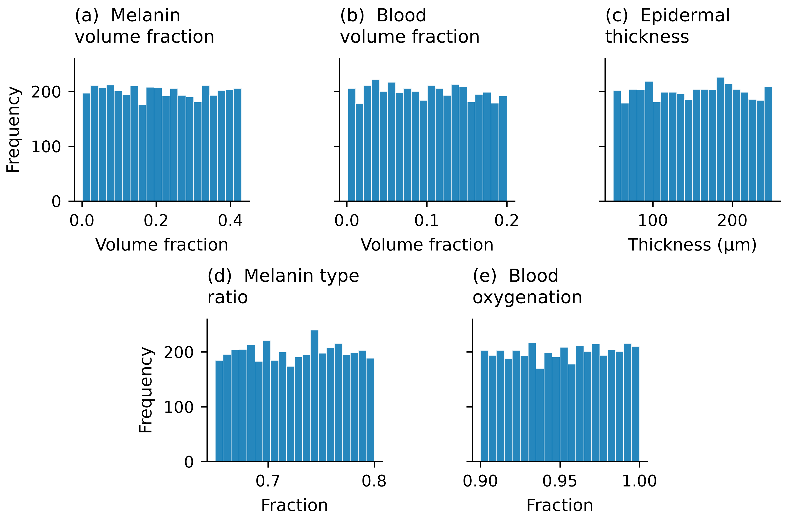

We evaluate 4,000 BioSkin-generated spectra against the International Skin
Spectra Archive (ISSA) using MI–EI screening followed by a conditional
spectral assessment. **733 spectra (18.325%) pass both stages.**

The [executed BVCM notebook](../notebooks/bvcm.ipynb) contains the complete
analysis. The [rerun report](rerun_report.qmd) documents the input correction,
parameter pairing, and changes relative to the previous dataset.

## Validation results

| Outcome | Number of spectra | Percentage and denominator |
|:--|--:|:--|
| Candidates | 4,000 | 100% of all candidates |
| Passed MI–EI screening | 1,167 | 29.175% of 4,000 |
| Rejected at Stage 1 | 2,833 | 70.825% of 4,000 |
| Passed conditional spectral assessment | 733 | 62.8% of 1,167 Stage 1 passes |
| Rejected at Stage 2 | 434 | 37.2% of 1,167 Stage 1 passes |
| Passed both stages | 733 | 18.325% of 4,000 |
| Rejected overall | 3,267 | 81.675% of 4,000 |

Stage 2 is evaluated only after a Stage 1 pass. Its Mahalanobis-distance
cutoff is **9.4114149808**, the 95th percentile of the ISSA training distances.
Rejection indicates inconsistency with this empirical reference under the
chosen criteria; it does not establish biological implausibility.

## Physical parameters

The inputs comprise melanin volume fraction, blood volume fraction,
epidermal thickness, melanin type ratio, and blood oxygenation.

## PCA comparison

PCA is fitted to ISSA only. BioSkin spectra and BVCM population predictions
are projected using the same ISSA mean and loadings. The first two components
explain 98.6% of ISSA variance; 22.775% of BioSkin spectra fall within the
nominal 95% Gaussian ISSA score ellipse. This comparison is descriptive and
is separate from the two-stage validation decision.

## Reproducibility

The reference uses 7,923 cleaned facial spectra, split into 6,338 training
and 1,585 test records. All 41 notebook code cells completed, and independent
Cholesky calculations verified the 4,000 exported decisions and distances.

- [Per-spectrum validation results (CSV)](../output/corrected_validation/per_spectrum_results.csv)
- [Validation summary and provenance (JSON)](../output/corrected_validation/summary.json)
- [PCA comparison (CSV)](../output/corrected_validation/pca_comparison.csv)
- [Standalone rerun report (HTML)](../output/corrected_validation/rerun_report.html)
- [Source code and data on GitHub](https://github.com/lasisilab/SkinSim_Quarto)
