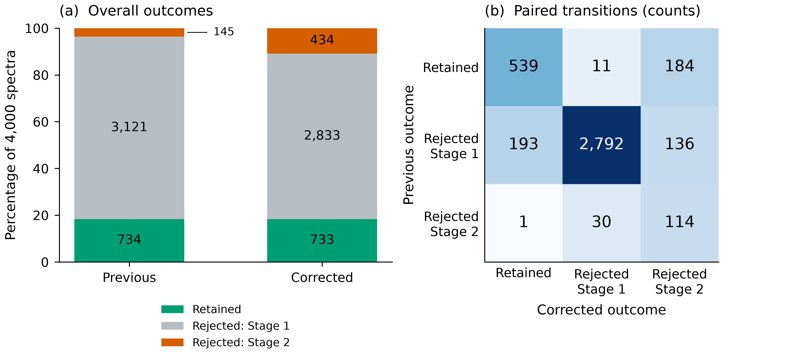

The validation rerun retains **733 of 4,000 spectra (18.325%)**, compared
with 734 in the previous dataset evaluated against the same fitted ISSA
reference. All 4,000 sample pairs were verified after swapping zero-based
network input slots 3 and 4.

**539 samples pass in both versions, 195 previously retained samples now
fail, and 194 newly pass.** Of the 195 lost acceptances, 11 fail MI–EI
screening and 184 fail the conditional spectral assessment.

The full report includes the numerical results, pairing checks, explanations
of changed decisions, model settings, and limitations:

[Read the full rerun report](../output/corrected_validation/rerun_report.html){.btn .btn-primary}

## Related analysis

- [BioSkin validation results and publication figures](bioskin_validation.qmd)
- [Executed BVCM notebook](../notebooks/bvcm.ipynb)
- [Paired outcomes (CSV)](../output/corrected_validation/paired_outcomes.csv)
- [Parameter-pairing audit (JSON)](../output/corrected_validation/parameter_pairing_audit.json)

Rejection means inconsistency with the ISSA reference under the specified
criteria. Further work is needed to classify rejection patterns and assess
whether they reflect gaps in empirical coverage.
