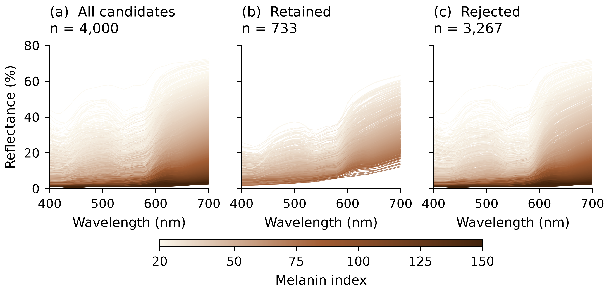
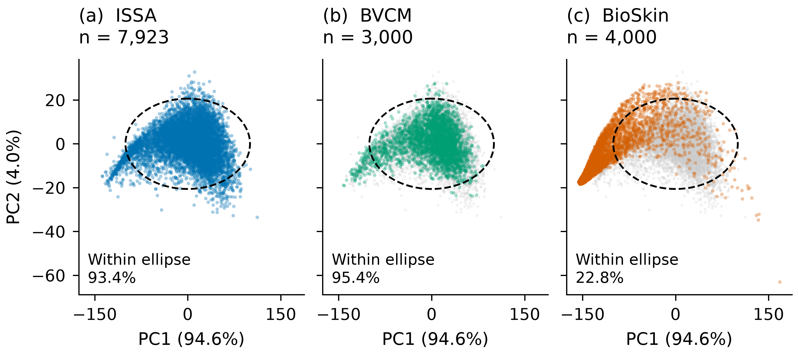

**Project:** Statistical characterization of spectral shape and chromophore-associated variation in human skin reflectance  
**Discussion:** “Writing up our collaborative work on skin spectra”

## Summary for coauthors

The rerun with Carlos's corrected BioSkin spectra retains **733 of 4,000 spectra (18.325%)**, compared with **734 (18.350%)** for the previous spectra evaluated against the same fitted ISSA reference. More corrected spectra pass the index criterion (1,167 versus 879), but fewer of those pass the conditional spectral criterion (62.8% versus 83.5%). The nearly identical final counts conceal substantial turnover: **539 samples pass in both versions, 195 previously retained samples now fail, and 194 newly pass**. All 4,000 sample pairs were verified through their skin parameters after swapping zero-based network slots 3 and 4. These results establish consistency with the chosen ISSA reference; they do not establish the biological validity or invalidity of rejected spectra.

## 1. Validation results

| Outcome | Previous spectra | Corrected spectra | Percentage denominator |
|:--|--:|--:|:--|
| Candidates | 4,000 | 4,000 | — |
| Passed Stage 1 | 879 (21.975%) | 1,167 (29.175%) | All 4,000 |
| Rejected at Stage 1 | 3,121 (78.025%) | 2,833 (70.825%) | All 4,000 |
| Passed Stage 2 | 734 (83.5%) | 733 (62.8%) | Stage 1 passes: 879 / 1,167 |
| Rejected at Stage 2 | 145 (16.5%) | 434 (37.2%) | Stage 1 passes: 879 / 1,167 |
| Passed both stages | 734 (18.350%) | 733 (18.325%) | All 4,000 |
| Rejected overall | 3,266 (81.650%) | 3,267 (81.675%) | All 4,000 |

Stage 2 is evaluated only after a Stage 1 pass. Stage 1 and Stage 2 rejection counts are mutually exclusive. The corrected retained spectra have melanin index (MI) **20.8522–97.1505** and erythema index (EI) **16.7856–49.5337**.

{width=6.5in}

The 195 lost acceptances comprise **11 new Stage 1 rejections and 184 new Stage 2 rejections**. The 194 new acceptances comprise 193 former Stage 1 rejections and one former Stage 2 rejection. Thus the net change of −1 spectrum does not mean that the retained sets are interchangeable.

{width=6.5in}

## 2. Verification that the samples are paired

The previous spectra are the existing file `new_sample_dataset_package/new_sample_spectral_reflectance_smoothed.csv`, which was referenced by the earlier `bvcm.ipynb`. It was not synthesized or reconstructed for this comparison. The corrected spectra are `bioskin_data/corrected_spectral_reflectance_smoothed.csv`. Sample IDs in the exported tables are **one-based CSV row numbers**, not participant identifiers.

For the network-ready parameter arrays, the verified relationship is:

~~~text
corrected ≈ previous[:, [0, 1, 2, 4, 3, 5]]
~~~

Slots are zero-based: slots 3 and 4 are the fourth and fifth CSV columns. In the corrected array, slot 3 contains the melanin type ratio and slot 4 contains blood oxygenation; slot 5 is the constant occlusion value 1.

- The swapped values match exactly for all **4,000** rows. Their unique paired values independently identify the corresponding previous row in every case.
- All six network parameters match after the swap within absolute tolerance **2 × 10⁻⁷**. The largest observed difference is **1.2 × 10⁻⁷** in normalized thickness; the first three columns have small CSV rounding differences.
- All five physical parameters match row by row within **1 × 10⁻⁷**; the largest observed difference is **3.47 × 10⁻⁸**. The physical CSV header order is unchanged and must **not** be swapped.
- A nearest-neighbor check using the complete reordered network vector confirms the same 4,000 row correspondences.

The intended physical settings are therefore preserved. Correcting the input order changes the spectrum produced for those settings. It does not represent a new random sample of skin parameters. Details are recorded in `parameter_pairing_audit.json` and `parameter_pairing_audit.csv`.

## 3. Why previously retained spectra now fail

The same fitted BVCM, residual covariance, GMM, and thresholds are used for both spectrum versions. However, MI and EI are recalculated from each version, so **both the observed curve and its MI/EI-conditioned prediction change**. Preserving physical parameters does not preserve the validation residual or decision.

Among the **184 samples newly rejected at Stage 2**, the median spectral Mahalanobis distance increases from **8.036 to 11.012**, crossing the fixed cutoff **9.41141**. Of these samples, 125 have corrected distances more than 10% above the cutoff. Their median paired changes are **+8.66 in MI** and **−4.54 in EI**.

**Example: sample 2408.** This actual sample was selected because its corrected distance is closest to the median of the 184 Stage 2 losses. MI changes from 75.04 to 82.03 and EI from 40.38 to 35.40. Its Stage 1 distance decreases from 1.130 to 0.779, remaining below 2.448, while its Stage 2 distance increases from **7.670 to 11.015**. The corrected curve is therefore closer to a GMM component in index space but farther from its BVCM prediction in covariance-weighted spectral space.

![Figure 3. Changed acceptance under the same fitted reference. (a) Previous and corrected curves for sample 2408, with their respective MI/EI-conditioned predictions. (b) Observed minus predicted logit reflectance. (c) Wavelength-wise RMS conditional standardized residuals across the 184 new Stage 2 rejections. (d) Paired distances for previously retained samples that still pass Stage 1; dashed lines mark the 9.41141 cutoff and the dotted line equality. The 11 new Stage 1 rejections are not evaluated at Stage 2 and are omitted from panel (d).](figures/rerun_changed_acceptance.png){width=6.5in}

Panel (c) uses the residual conditional on the other wavelengths, standardized by its conditional standard deviation: for residual row vector *e* and precision matrix *P*, coordinate *j* is *(eP)ⱼ / √Pⱼⱼ*. These diagnostics account for wavelength correlations; their squared values are **not additive contributions** to the total squared Mahalanobis distance. The strongest corrected RMS values occur at 580 and 560 nm (3.83 and 3.75), with additional deviations elsewhere. They locate conditional discrepancies without proving a unique physical cause.

## 4. Reference model and analysis settings

The ISSA workbook is `data/ISSA_17_Jan_2025_Yan_Lu.xlsx`. The six facial sites contain 8,033 records before derivative screening and **7,923 after screening**. A record is excluded when its Savitzky–Golay first derivative (five-point window, cubic polynomial) differs from the wavelength-specific mean by more than five standard deviations at any wavelength. The notebook's seeded split gives **6,338 training and 1,585 test spectra**. This is a record-level split; it does not guarantee participant independence between sets.

Each supplied BioSkin spectrum contains 310 values from 380 to 998 nm at 2-nm spacing. Validation selects the **31 matching wavelengths from 400 to 700 nm at 10-nm spacing**, without interpolation. Input fractions are converted to reflectance percentages once. MI is 100 log₁₀(100/R₆₈₀), and EI is 100 log₁₀(R₆₈₀/R₅₆₀), with *R* expressed as percent. The BVCM logit transformation uses fractions.

**Stage 1:** the minimum Mahalanobis distance to the five full-covariance GMM components must be ≤ **2.4477468307** (the square root of the 95th percentile of χ² with two degrees of freedom). The mixture is fitted to all cleaned facial spectra. The union of component ellipses is an operational criterion, not a calibrated 95% region of the mixture distribution.

**Stage 2:** the full logit residual is evaluated using the learned Gaussian-process-plus-noise covariance. The cutoff **9.4114149808** is the 95th percentile of training distances. The threshold is calibrated in sample and is not a guaranteed 95% acceptance rate on new populations. No thresholds were tuned to the corrected BioSkin candidates.

The downloaded `bvcm_issa_face_posterior.npz` did not contain a compatible labeled covariance state for this implementation and had 8,033 deviation rows. It was preserved. The existing Gibbs model was refitted with 10,000 tuning and 10,000 sampling iterations, thinning by 10 to retain **1,000 draws**. The resulting reference is saved in `data/bvcm_gibbs_validation_checkpoint.npz`. This fit recovers the previous dataset's 879 Stage 1 passes and 734 final passes. Posterior hyperparameter acceptance was 15.88%. Both datasets in this report were evaluated using that same reference.

| ISSA evaluation | R² | RMSE (percentage points) | MAE (percentage points) |
|:--|--:|--:|--:|
| Training, population component | 0.965248 | 1.411095 | 1.053455 |
| Training, population + fitted deviations | 0.999319 | 0.197515 | 0.131818 |
| Test, population component | 0.964578 | 1.428091 | 1.069630 |

Training reconstruction with fitted deviations is an in-sample assessment. For held-out spectra, predictions use only the population component.

## 5. PCA comparison

PCA is fitted to the 7,923 ISSA facial spectra after wavelength-wise centering, without variance standardization. All datasets are projected onto the same basis. PC1 and PC2 explain **94.6% and 4.0%** of ISSA variance, respectively (**98.6% combined**).

The nominal 95% Gaussian score ellipse contains **22.775% of corrected BioSkin spectra**, **95.4% of 3,000 BVCM population predictions**, and **93.4% of ISSA spectra**. It uses the ISSA score mean and covariance with the χ²₂,₀.₉₅ cutoff; it describes dispersion rather than confidence in the mean. BVCM curves use GMM-sampled MI/EI pairs and exclude random deviations. This comparison is descriptive and does not enter either validation stage.

{width=6.5in}

## 6. Interpretation and remaining work

This rerun completes the corrected-data validation and establishes the paired changes in decisions. It does **not** yet classify all rejection mechanisms or establish missing ISSA coverage as their cause. In particular, only 2 of the 184 new Stage 2 rejections have corrected MI ≥ 100; attributing this group wholesale to very dark skin absent from ISSA would not be supported by this analysis. MI alone also does not establish a demographic category.

The next analysis should distinguish index-space departures from conditional shape departures, group the rejected spectra by spectral pattern and physical parameters, and compare those groups with ISSA coverage by site and relevant measurement metadata. This should test the dark-skin coverage hypothesis alongside simulation, measurement, and model explanations.

## 7. Reproducibility and manuscript changes

All **41 notebook code cells completed without errors**. An independent Cholesky-based calculation verified all 4,000 corrected decisions and exported distances. A seeded comparison verified that accumulating mean deviations without storing every deviation draw preserves the sampler's parameter draws and mean deviations.

The following files in `output/corrected_validation/` provide the audit trail:

| File | Contents |
|:--|:--|
| `summary.json`, `input_audit.json` | Input hashes, software versions, fit provenance, counts, and thresholds |
| `reference_state.npz` | GMM, BVCM coefficients, covariance, threshold, split, and PCA basis |
| `per_spectrum_results.csv` | Parameters, indices, distances, and outcomes for all 4,000 corrected spectra |
| `previous_vs_corrected.csv`, `paired_outcomes.csv`, `outcome_transitions.csv` | Dataset comparison and sample-level transitions |
| `parameter_pairing_audit.json`, `parameter_pairing_audit.csv` | Slot permutation and row-matching checks |
| `previously_retained_now_rejected.csv` | The 195 lost acceptances |
| `changed_acceptance_diagnostics.json`, `lost_stage2_wavelength_diagnostics.csv` | Group statistics and conditional residual diagnostics |
| `pca_comparison.csv`, `figure_manifest.json` | PCA summary and figure export hashes |

The manuscript sections `bvcm.tex` and `validation.tex` now use the corrected results, explicit percentage denominators, the actual stored-draw count, and record-level split terminology. `Styles/neurips_2024.tex` remains the entry point, with section, figure, and bibliography paths resolved relative to its folder. Eight manuscript figures and two report figures use consistent typography, colorblind-friendly colors, labeled units, and shared axes where comparisons require them. Manuscript figures match the current 5.5-inch text width to preserve readable label sizes. Figures are supplied as vector PDFs with dense data layers rasterized at 600 dpi, plus 600-dpi PNGs. **No TeX-to-PDF compilation was performed for this update.**

To verify results and regenerate figures, run from `SkinSim_Quarto`:

~~~powershell
.\.venv\Scripts\python.exe code/check_bioskin_rerun.py
.\.venv\Scripts\python.exe code/audit_bioskin_parameter_pairing.py
.\.venv\Scripts\python.exe code/analyze_changed_acceptance.py
.\.venv\Scripts\python.exe code/publication_figures.py
.\.venv\Scripts\python.exe code/export_rerun_report.py
~~~

`rerun_report.html` is a self-contained reading copy with embedded figures;
`rerun_report.md` is the editable text source. The published website links
to the HTML report and the supporting validation results. No email was sent.
